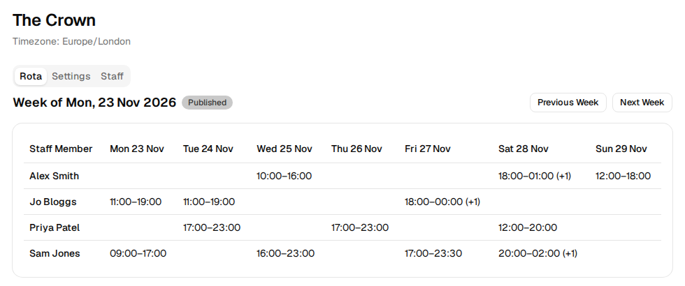
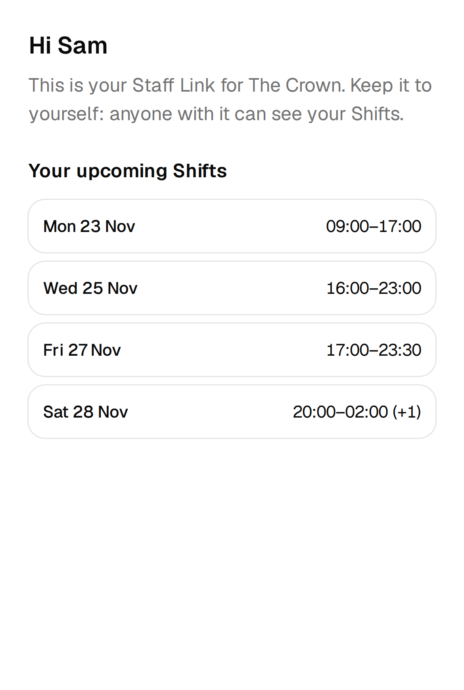
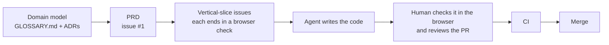

# Rota Ready

**Weekly staff rotas for UK bars and restaurants.** Owners build the week, and staff confirm their shifts from a private link.

[](https://github.com/sjblurton/rota-ready/actions/workflows/ci.yml)
[](https://rota-ready.onrender.com)
[](https://github.com/users/sjblurton/projects/1)
[](https://github.com/sjblurton/rota-ready/issues/1)

<table>
  <tr>
    <td></td>
    <td></td>
  </tr>
  <tr>
    <td align="center"><em>The Owner builds and Publishes the Week</em></td>
    <td align="center"><em>Sam opens their Staff Link</em></td>
  </tr>
</table>

Built by an ex-chef who has been on the wrong end of a WhatsApp rota.

**Built AI-first, human-verified.** AI agents write the code from small, fully specified tickets. I check every change in the browser, review it, and only merge it when tests against a real database pass. [How it's built](#how-its-built) explains the workflow and what "verified" means here.

---

## How it's built



### What "verified" means

- **Every PR has a "How I verified it" section**: browser steps a reviewer can repeat, plus the automated tests that cover the change.
- **Integration tests hit a real Postgres database.** No mocked ORM, and no transaction rollback hiding bugs that only show up when a transaction actually commits.
- **Nothing fakes the API.** No MSW or mocked API client in the web app. The only test doubles sit at outside boundaries (email outbox, clock, JWT signing key).
- **Cross-venue 404 tests.** For every venue-scoped route, a member of venue A asks for venue B's data and must get a 404.
- **A Playwright journey that grew with each slice.** The whole owner-and-staff journey runs in CI against the real stack.
- **Screenshots of every journey step.** CI attaches them to each PR as a `journey-screenshots` download, so a reviewer can see each screen without running the app. A "CI report" comment on the PR links them, with test coverage for every source file and for the files the PR changed. Coverage is information only and never fails the build.

### Lessons from the first attempt

The first version had 100% test coverage and still had serious bugs, because the tests mocked out the parts where the bugs were. The worst one: a valid login was treated as permission to see _any_ venue's data. The mocks agreed with the code, so the tests passed.

This repo is set up so that bug can't hide:

- **Access is checked in one place.** Every venue route lives under `/api/venues/:venueId/...`, behind a single membership check that returns 404 to anyone who isn't a member ([ADR-0001](docs/adr/0001-venue-membership-and-404-scoping.md)).
- **Tests run the real code.** The API is built by a single `createApp()` factory that tests and production share, with no `NODE_ENV` switches. The database, clock, email and auth are passed into `createApp` as dependencies (ADR-0004), so tests use the same auth and membership checks as production.
- **The rule is enforced in review.** A cross-venue test is required for every venue route, and the PR template checks for it.

### Skills used

- [Matt Pocock's skills](https://github.com/mattpocock/skills): domain modelling, spec writing and ticket breakdown.
- The project's own [`scenario-tests`](.claude/skills/scenario-tests/SKILL.md) skill: `describe("when …")` scenarios, setup in `beforeEach`, one focused assertion per test.

---

## For engineers

### Stack

| Layer | Choice |
| --- | --- |
| Web | Vite, React 19 with React Compiler, TanStack Router + Query, Tailwind, shadcn/ui |
| API | Express 5, Zod (shared with the web app) |
| Data | Prisma 7 on Supabase Postgres (local stack via the Supabase CLI) |
| Auth | Supabase Auth (email and password), JWTs checked by the API against Supabase's signing keys |
| Email | nodemailer over SMTP: local Supabase inbox (Mailpit) in dev and Playwright, Resend in production |
| Tests | Vitest, Playwright |
| Tooling | pnpm workspaces, TypeScript strict, ESLint, mise (Node 26), GitHub Actions |

```
apps/
  api/                 Express API, built by createApp()
    src/features/      One folder per glossary area, split into router, controller, service and data
    src/lib/           Infrastructure: database client, clock, HTTP errors, auth
  web/                 Vite + React single-page app
    src/features/      One folder per glossary area: components, queries and mutations
packages/
  shared/              Zod schemas and pure domain logic used by both apps
docs/
  adr/                 Architecture decision records
  agents/              Configuration for the agent skills
  building-ui.md       How components are composed from shadcn/ui
GLOSSARY.md            The domain language (Venue, Rota, Shift, Staff Link, …)
CODING_STANDARDS.md    The judgement calls a reviewer checks in every diff
```

### Key decisions

- [ADR-0001](docs/adr/0001-venue-membership-and-404-scoping.md): access goes through a Venue Member table, and anything outside your venues is a 404.
- [ADR-0002](docs/adr/0002-staff-link-tokens-hashed-and-encrypted.md): staff link tokens are stored as a SHA-256 hash for lookup plus an AES-256-GCM encrypted copy.
- [ADR-0003](docs/adr/0003-shift-times-utc-week-by-start-in-venue-timezone.md): shifts store UTC instants; the day and week come from the start time in the venue's timezone.
- [ADR-0004](docs/adr/0004-stack.md): stack choices, including the Vite single-page app, React Compiler and email over SMTP.
- [ADR-0005](docs/adr/0005-i18n-english-only-with-typed-keys.md): all UI text goes through typed i18next keys, dates through shared `Intl` helpers, and API errors carry a code instead of a message.
- [ADR-0006](docs/adr/0006-hosting-on-render-with-migrations-from-github-actions.md): the web app and API run on Render from one origin, and GitHub Actions runs migrations before each deploy.
- [ADR-0007](docs/adr/0007-forms-with-react-hook-form-and-shared-zod-schemas.md): forms use React Hook Form, validated by the same shared Zod schemas as the API, with translated messages.
- [ADR-0008](docs/adr/0008-feature-folders-for-apps-web.md): `apps/web` groups code into feature folders named after glossary terms.
- [ADR-0009](docs/adr/0009-where-errors-show.md): errors show where the user can fix them, and never reveal which accounts exist.
- [ADR-0010](docs/adr/0010-api-feature-folders-with-layers.md): `apps/api` uses the same feature folders, each split into router, controller, service and data layers, with lint enforcing the imports between them.
- [ADR-0011](docs/adr/0011-no-code-comments.md): code carries no comments; names, structure and tests carry the meaning, and lint enforces it.

### Testing approach

| Seam | What it covers | Tooling |
| --- | --- | --- |
| HTTP API | Almost all behaviour, including auth failures and cross-venue 404s | Vitest against `createApp`, real Postgres (a dedicated test database, truncated before each test) |
| Email | Who was and wasn't emailed, and which link they got | In-memory outbox passed into `createApp` from #11 |
| Clock | "Upcoming", "has started", "No reply", March/October clock changes | API tests run on a fixed default instant passed into `createApp`; a time scenario sets its own. React and shared tests take instants as input. No test result depends on the day it runs |
| Shared logic | Week attribution, time validation, token encryption | Vitest unit tests in `packages/shared` |
| End to end | One growing journey through the real stack, on real time, with its Shifts two Weeks ahead so none starts during a run | Playwright against local Supabase (`apps/web/e2e/journey.e2e.ts`) |

### Getting started

**Prerequisites:** [mise](https://mise.jdx.dev/), which installs the pinned Node 26 and pnpm, and Docker, which runs the local Supabase stack. The Supabase CLI is a dev dependency, so `pnpm install` brings it. On Linux with Docker Desktop, run `docker context use desktop-linux` once.

```sh
mise trust && mise install   # Node 26 + pnpm, pinned in mise.toml
pnpm install                 # also generates the Prisma client
cp .env.example .env         # values match the local Supabase stack
pnpm db:start                # local Supabase (Postgres + Auth) in Docker; first run downloads images
pnpm db:migrate              # apply Prisma migrations to the local database
pnpm dev                     # web on http://localhost:5173, API on http://localhost:3000
```

Open http://localhost:5173 and you'll land on the login page. Create an account (local sign-ups need no email confirmation); your email address appears in the header, and the page shows **API ok · DB ok**, fetched live from the API. Run `pnpm db:stop` and it switches to **API ok · DB down** within a few seconds; stop the API and it shows **API unreachable**. Open http://localhost:5173/?lng=pseudo to see every string as pseudo-text (dev builds only), so any untranslated text stands out.

Every email the app sends locally, such as the Staff Link email from Publish, lands in the local Supabase inbox (Mailpit) at http://127.0.0.1:54324, while `pnpm db:start` is running.

| Command | What it does |
| --- | --- |
| `pnpm test` | Unit and integration tests (Vitest) in every package. Needs `.env` and the local Supabase stack running (`pnpm db:start`). |
| `pnpm test:coverage` | The same tests with V8 coverage, written to each package's `coverage/`. It counts every source file, including ones no test loads. |
| `pnpm --filter @rota-ready/web e2e` | The Playwright journey against the real stack. Starts the API and web dev servers itself (or reuses running ones); needs the local Supabase stack. First run: `pnpm --filter @rota-ready/web exec playwright install chromium`. |
| `pnpm --filter @rota-ready/web e2e:isolated` | The same journey on its own servers (API `:3200`, web `:5273`), so it never tests dev servers already running from another branch. Add `E2E_SCREENSHOTS=<dir>` to either command to save a screenshot after every step. |
| `pnpm lint` | ESLint, including the React Compiler rules, with warnings treated as errors |
| `pnpm typecheck` | TypeScript in every package |
| `pnpm build` | Production builds of the web app and the API |
| `pnpm --filter @rota-ready/api start` | Runs the built API (after `pnpm build`) |
| `pnpm db:stop` | Stops the local Supabase stack |
| `pnpm db:reset` | Wipes the local database, including Users and logins, and re-applies the Prisma migrations. Use it when a migration you'd already applied has changed. |
| `pnpm --filter @rota-ready/api db:migration --name <name>` | Creates a new migration from changes to `apps/api/prisma/schema.prisma` |

Integration tests create a fresh `rota_ready_test` database each run, apply the migrations once, and truncate every table before each test. They check tokens against a key pair generated in the test, through the same verifier production uses.

### Production

**Live:** https://rota-ready.onrender.com. The API sleeps after 15 minutes without traffic, so the first request after a quiet spell takes about a minute.

Merging to `main` runs CI, then the `deploy` job: it applies Prisma migrations to the production database, deploys the API at that exact commit and waits until it's live, then does the same for the web app. The job fails if a Render deploy fails ([ADR-0006](docs/adr/0006-hosting-on-render-with-migrations-from-github-actions.md)). Each layer goes live before the one above it, so every migration must work with the API that's already running, and every API change with the web app that's already running.

Secrets live in the hosts' secret stores, never in the repo:

| Where | Name | What it is |
| --- | --- | --- |
| GitHub `production` environment | `DATABASE_URL` | Supabase session pooler connection string (port 5432), used for migrations |
| GitHub `production` environment | `RENDER_API_DEPLOY_HOOK` | Deploy hook URL of the `rota-ready-api` service |
| GitHub `production` environment | `RENDER_WEB_DEPLOY_HOOK` | Deploy hook URL of the `rota-ready` static site |
| GitHub `production` environment | `RENDER_API_KEY` | Render API key with read access to deploys, used to wait for each deploy to go live |
| GitHub `production` environment (variable, not secret) | `RENDER_API_SERVICE_ID`, `RENDER_WEB_SERVICE_ID` | The `srv-…` IDs of `rota-ready-api` and `rota-ready` |
| Render `rota-ready-api` | `DATABASE_URL` | Same session pooler connection string |
| Render `rota-ready-api` | `SUPABASE_URL` | `https://<project-ref>.supabase.co`; the API checks tokens against its JWKS |
| Render `rota-ready-api` | `STAFF_LINK_KEY` | 32 random bytes, base64 (`openssl rand -base64 32`), encrypting stored Staff Link tokens ([ADR-0002](docs/adr/0002-staff-link-tokens-hashed-and-encrypted.md)). The API won't start without it, and losing it means regenerating every Staff Link |
| Render `rota-ready` | `VITE_SUPABASE_URL` | Same Supabase URL, built into the web app |
| Render `rota-ready` | `VITE_SUPABASE_PUBLISHABLE_KEY` | Supabase publishable key (`sb_publishable_…`), safe to ship to browsers |
| Render `rota-ready-api` | `SMTP_URL` | Resend's SMTP endpoint with the API key as the password: `smtps://resend:<api-key>@smtp.resend.com:2465`. Use port 2465, because Render's free plan blocks outbound 25, 465 and 587, so sends on those ports time out and show as Failed |
| Render `rota-ready-api` | `EMAIL_FROM` | `Rota Ready <onboarding@resend.dev>`, Resend's test sender, until a domain is verified in Resend. It only delivers to the Resend account's own address, so emails to anyone else show as Failed |
| Render `rota-ready-api` | `WEB_URL` | `https://rota-ready.onrender.com`, the base of the Staff Links in emails |

The Supabase project has the Data API and "Automatically expose new tables" turned off, uses asymmetric (ES256) JWT signing keys, and has email confirmation off until SMTP arrives in #11. Supabase has no setting that turns RLS on for tables created by migrations, so the security baseline migration's event trigger does it. Both Render services track `main`.

### Roadmap

The MVP is complete. Its tickets, in order, each ending with a check you can click in the browser:

- [x] [#2](https://github.com/sjblurton/rota-ready/issues/2) App shell: monorepo, web app, API health check, CI
- [x] [#3](https://github.com/sjblurton/rota-ready/issues/3) Database: Prisma, local Supabase Postgres, integration test harness
- [x] [#17](https://github.com/sjblurton/rota-ready/issues/17) i18n foundation (English only)
- [x] [#4](https://github.com/sjblurton/rota-ready/issues/4) Sign up, log in, log out
- [x] [#5](https://github.com/sjblurton/rota-ready/issues/5) Create and rename the venue
- [x] [#6](https://github.com/sjblurton/rota-ready/issues/6) Deploy to production
- [x] [#7](https://github.com/sjblurton/rota-ready/issues/7) Manage staff members
- [x] [#8](https://github.com/sjblurton/rota-ready/issues/8) View a week and add shifts
- [x] [#9](https://github.com/sjblurton/rota-ready/issues/9) Edit and delete shifts
- [x] [#10](https://github.com/sjblurton/rota-ready/issues/10) Publish and the staff link page
- [x] [#11](https://github.com/sjblurton/rota-ready/issues/11) Publish emails staff links
- [x] [#12](https://github.com/sjblurton/rota-ready/issues/12) Confirm and decline
- [x] [#13](https://github.com/sjblurton/rota-ready/issues/13) Changes after publishing
- [x] [#14](https://github.com/sjblurton/rota-ready/issues/14) Send updates

Stretch goals:

- [x] [#15](https://github.com/sjblurton/rota-ready/issues/15) Copy last week
- [ ] Later: SMS links, open (unassigned) shifts, managers and multiple venues, shift swaps, availability and time off

---

## Author

**Simon Blurton**: [LinkedIn](https://www.linkedin.com/in/simon-blurton)

© Simon Blurton. All rights reserved. The code is public for portfolio purposes only. No licence is granted to use, copy, modify or distribute it.
