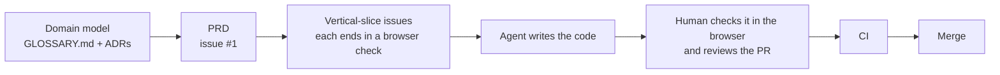

# Rota Ready

**Weekly staff rotas for UK pubs, bars and restaurants.** Owners build the week, and staff confirm their shifts from a private link.

[](https://github.com/sjblurton/rota-ready/actions/workflows/ci.yml)

[](https://github.com/users/sjblurton/projects/1)
[](https://github.com/sjblurton/rota-ready/issues/1)

> 📸 _Screenshot coming soon: the owner's rota grid next to the staff member's mobile view._

Built by an ex-chef who has been on the wrong end of a WhatsApp rota.

**Built AI-first, human-verified.** AI agents write the code from small, fully specified tickets. I check every change in the browser, review it, and only merge it when tests against a real database pass. [How it's built](#how-its-built) explains the workflow and what "verified" means here.

---

## How it's built



### What "verified" means

- **Every PR has a "How I verified it" section**: browser steps a reviewer can repeat, plus the automated tests that cover the change.
- **Integration tests hit a real Postgres database.** No mocked ORM, and no transaction rollback hiding bugs that only show up when a transaction actually commits.
- **Nothing fakes the API.** No MSW or mocked API client in the web app. The only test doubles sit at outside boundaries (email outbox, clock, JWT signing key).
- **Cross-venue 404 tests.** For every venue-scoped route, a member of venue A asks for venue B's data and must get a 404.
- **A Playwright journey that grows with each slice.** By the end of the MVP, the whole owner-and-staff journey runs in CI against the real stack.

### Lessons from the first attempt

The first version had 100% test coverage and still had serious bugs, because the tests mocked out the parts where the bugs were. The worst one: a valid login was treated as permission to see _any_ venue's data. The mocks agreed with the code, so the tests passed.

This repo is set up so that bug can't hide:

- **Access is checked in one place.** Every venue route lives under `/api/venues/:venueId/...`, behind a single membership check that returns 404 to anyone who isn't a member ([ADR-0001](docs/adr/0001-venue-membership-and-404-scoping.md)).
- **Tests run the real code.** The API is built by `createApp({ db, clock, emailSender, authConfig })`, so tests use the same auth and membership checks as production, with no `NODE_ENV` switches.
- **The rule is enforced in review.** A cross-venue test is required for every venue route, and the PR template checks for it.

### Skills used

- [Matt Pocock's skills](https://github.com/mattpocock/skills): domain modelling, spec writing and ticket breakdown.
- The project's own [`scenario-tests`](.claude/skills/scenario-tests/SKILL.md) skill: `describe("when …")` scenarios, setup in `beforeEach`, one focused assertion per test.

---

## For engineers

### Stack

| Layer | Choice |
| --- | --- |
| Web | Vite, React 19 with React Compiler, TanStack Router + Query, Tailwind, shadcn/ui |
| API | Express 5, Zod (shared with the web app) |
| Data | Prisma on Supabase Postgres _(from #3)_ |
| Auth | Supabase Auth _(from #4)_ |
| Email | nodemailer over SMTP: local Supabase inbox in dev, Resend in production _(from #11)_ |
| Tests | Vitest, Playwright _(from #4)_ |
| Tooling | pnpm workspaces, TypeScript strict, ESLint, mise (Node 26), GitHub Actions |

```
apps/
  api/        Express API, built by createApp()
  web/        Vite + React single-page app
packages/
  shared/     Zod schemas and pure domain logic used by both apps
docs/
  adr/        Architecture decision records
  agents/     Configuration for the agent skills
GLOSSARY.md   The domain language (Venue, Rota, Shift, Staff Link, …)
```

### Key decisions

- [ADR-0001](docs/adr/0001-venue-membership-and-404-scoping.md): access goes through a Venue Member table, and anything outside your venues is a 404.
- [ADR-0002](docs/adr/0002-staff-link-tokens-hashed-and-encrypted.md): staff link tokens are stored as a SHA-256 hash for lookup plus an AES-256-GCM encrypted copy.
- [ADR-0003](docs/adr/0003-shift-times-utc-week-by-start-in-venue-timezone.md): shifts store UTC instants; the day and week come from the start time in the venue's timezone.
- [ADR-0004](docs/adr/0004-stack.md): stack choices, including the Vite single-page app, React Compiler and email over SMTP.

### Testing approach

| Seam | What it covers | Tooling |
| --- | --- | --- |
| HTTP API | Almost all behaviour, including auth failures and cross-venue 404s | Vitest against `createApp`, real Postgres from #3 |
| Email | Who was and wasn't emailed, and which link they got | In-memory outbox passed into `createApp` |
| Clock | "Upcoming", "has started", March/October clock changes | Fixed clock passed into `createApp` |
| Shared logic | Week attribution, time validation, token encryption | Vitest unit tests in `packages/shared` |
| End to end | One growing journey through the real stack | Playwright against local Supabase from #4 |

### Getting started

**Prerequisites:** [mise](https://mise.jdx.dev/), which installs the pinned Node 26 and pnpm. Docker and the [Supabase CLI](https://supabase.com/docs/guides/local-development/cli/getting-started) are needed from the database ticket (#3) onwards.

```sh
mise trust && mise install   # Node 26 + pnpm, pinned in mise.toml
pnpm install
cp .env.example .env         # optional: every value has a working default
pnpm dev                     # web on http://localhost:5173, API on http://localhost:3000
```

Open http://localhost:5173. The page shows **API ok**, fetched live from the API. Stop the API and it switches to **API unreachable** within a few seconds.

| Command | What it does |
| --- | --- |
| `pnpm test` | Unit and API tests (Vitest) in every package |
| `pnpm lint` | ESLint, including the React Compiler rules, with warnings treated as errors |
| `pnpm typecheck` | TypeScript in every package |
| `pnpm build` | Production builds of the web app and the API |
| `pnpm --filter @rota-ready/api start` | Runs the built API (after `pnpm build`) |

Integration tests against Postgres arrive with #3, and Playwright with #4.

### Roadmap

MVP, in order. Each ticket ends with a check you can click in the browser:

- [ ] [#2](https://github.com/sjblurton/rota-ready/issues/2) App shell: monorepo, web app, API health check, CI
- [ ] [#3](https://github.com/sjblurton/rota-ready/issues/3) Database: Prisma, local Supabase Postgres, integration test harness
- [ ] [#17](https://github.com/sjblurton/rota-ready/issues/17) i18n foundation (English only)
- [ ] [#4](https://github.com/sjblurton/rota-ready/issues/4) Sign up, log in, log out
- [ ] [#5](https://github.com/sjblurton/rota-ready/issues/5) Create and rename the venue
- [ ] [#6](https://github.com/sjblurton/rota-ready/issues/6) Deploy to production
- [ ] [#7](https://github.com/sjblurton/rota-ready/issues/7) Manage staff members
- [ ] [#8](https://github.com/sjblurton/rota-ready/issues/8) View a week and add shifts
- [ ] [#9](https://github.com/sjblurton/rota-ready/issues/9) Edit and delete shifts
- [ ] [#10](https://github.com/sjblurton/rota-ready/issues/10) Publish and the staff link page
- [ ] [#11](https://github.com/sjblurton/rota-ready/issues/11) Publish emails staff links
- [ ] [#12](https://github.com/sjblurton/rota-ready/issues/12) Confirm and decline
- [ ] [#13](https://github.com/sjblurton/rota-ready/issues/13) Changes after publishing
- [ ] [#14](https://github.com/sjblurton/rota-ready/issues/14) Send updates

Stretch goals:

- [ ] [#15](https://github.com/sjblurton/rota-ready/issues/15) Copy last week
- [ ] Later: SMS links, open (unassigned) shifts, managers and multiple venues, shift swaps, availability and time off

---

## Author

**Simon Blurton**: [LinkedIn](#) _(link coming soon)_ · [Portfolio](#) _(link coming soon)_

© Simon Blurton. All rights reserved. The code is public for portfolio purposes only. No licence is granted to use, copy, modify or distribute it.
